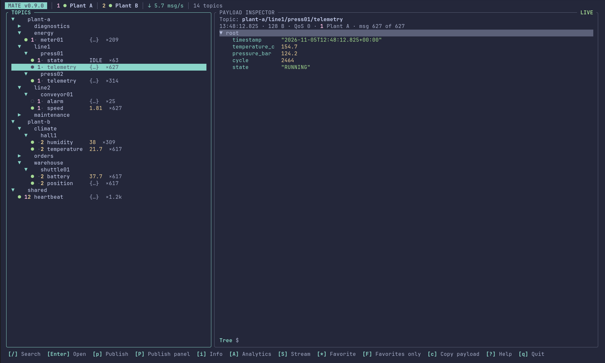
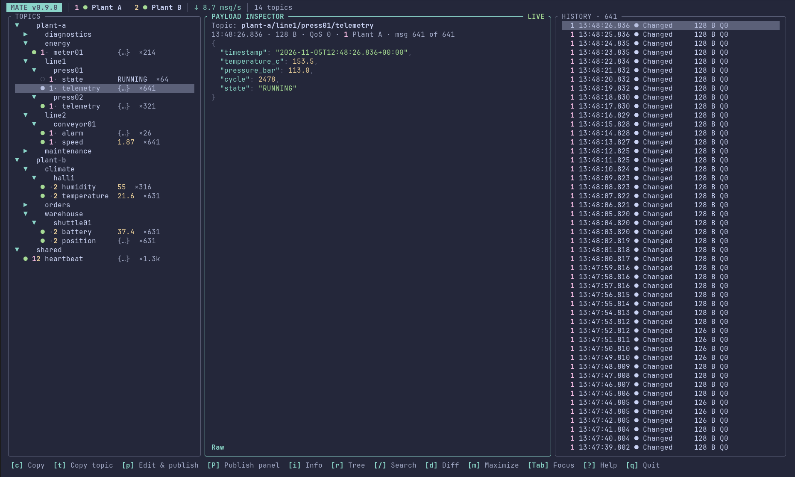
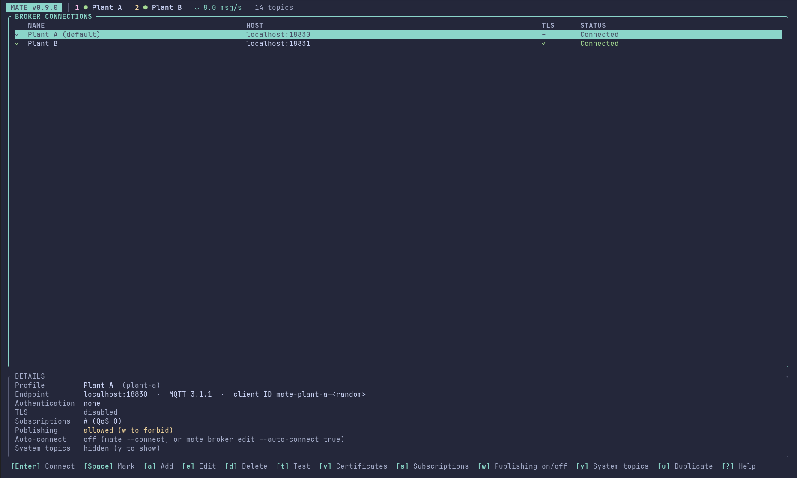

# MATE

[](https://github.com/zimmergroup/mate/actions/workflows/ci.yml)

MQTT Administration & Terminal Environment is a keyboard-driven terminal client for browsing MQTT topics and inspecting live payloads.

## Status

MATE is under active development; [CHANGELOG.md](CHANGELOG.md) lists the changes of every version and [ROADMAP.md](ROADMAP.md) what is done and what is open.

The TUI is a topic explorer with a payload inspector (interactive JSON tree with search, diff and copy), an optional message history, a stream of all messages and connection events, analytics rankings, publishing (dialog or docked panel), logging to `.mqttlog` files and replaying them. Several brokers can be connected at once. The connector handles MQTT 3.1.1 and MQTT 5, several subscriptions per broker (also changeable while connected), Rustls TLS/mTLS and OS-keyring password lookup. Broker profiles have stable IDs and their own directories with `broker.toml`; the CLI and TUI share the same broker store.

Real-broker checks cover Linux with Mosquitto (plain, TLS, mTLS, MQTT 5, live subscribe/unsubscribe, authentication failure without retry, reconnect with resubscribe) and scripted pseudo-terminal sessions of the TUI. A Windows build is cross-compiled in CI and was confirmed to run in a Windows VM; macOS has not been checked by hand.

## Install

Download the archive for your platform from the [Releases](https://github.com/zimmergroup/mate/releases) page together with its `.sha256` file, verify and unpack it (Linux x86_64):

```sh
sha256sum -c mate-<version>-x86_64-linux.tar.gz.sha256
tar -xzf mate-<version>-x86_64-linux.tar.gz
./mate-<version>-x86_64-linux/mate --help
```

The Linux binary is built on a current Ubuntu image and needs a reasonably recent glibc; if it does not start on an older distribution, build from source. For Windows the release has `mate-<version>-x86_64-windows.zip` (with `.sha256`); unpack it and run `mate.exe` in Windows Terminal. This build is cross-compiled on Linux. It was confirmed to run in a Windows VM; broker connections, the credential store and certificate permissions have not been checked in detail. Copying to the clipboard uses the OSC 52 fallback. The executable is unsigned, so SmartScreen may warn. Passwords are read from the OS credential store (Secret Service on Linux).

To build from source (stable Rust 1.88 or newer):

```sh
cargo install --git https://github.com/zimmergroup/mate.git --tag v<version> --locked
```

## Build and run

Requires stable Rust (1.88 or newer).

```sh
cargo run
cargo run -- --help
cargo test
cargo fmt --check
cargo clippy --all-targets --all-features -- -D warnings
```

## Using the TUI



The status bar shows the connected broker, its connection state and, only for an established connection, the MQTT version, TLS use, incoming message rate and topic count. Messages are labelled `LIVE`, `RETAINED` or `CACHED`. A context-sensitive shortcut bar lists the keys that work for the focused panel; `?` shows all of them.

| Keys | Action |
| --- | --- |
| `o` / `x` | Connect the selected (or only/default) broker / disconnect |
| `b` | Broker manager (there: `a` adds a broker) |
| `Space` (broker manager) | Mark brokers; `Enter` then connects all marked ones at once (see "Several brokers" in the [user guide](docs/user-guide.md)) |
| `L` | Logging dialog: write every received message to `.mqttlog` files (one per broker, day and size block) |
| `R` | Replay menu: play recorded `.mqttlog` files to any connected broker (`Space` pause, `m` mode, `+`/`-` speed) |
| `y` (broker manager) | Show or hide the broker's `$SYS/#` system topics (off by default) |
| `s` (broker manager) | Subscriptions of the selected broker: `Space` on/off, `a` add, `x` exclude a filter, `d` remove, `0`/`1`/`2` QoS |
| `Tab`, `Shift+Tab` | Next / previous panel |
| `m` | Maximize or restore the focused panel |
| `h` | Show or hide the history panel |
| `<` `>` or `Ctrl+Left` `Ctrl+Right` | Narrow / widen the focused panel |
| `/` | Filter topics (topics), search the payload (inspector), filter messages by payload or MQTT 5 property (history) |
| `+`, `-`, `Shift+←/→` | Expand all / collapse all topics; open / close the selected branch with its subtree (topics) |
| `S` | Stream: all messages and connection events in arrival order; `Enter` details, `Space` pause, `/` topic filter, `f` find in payload and properties, `R` retained only, `C` clear the list, `e` events, `s` show in tree, `Esc` back |
| `A` | Analytics: seven rankings (frequency, not JSON, quiet, jitter, largest, retained, branches); `Tab`/`1`-`7` list, `s` sort, `r` reverse, `f` kind filter, `d` depth, `/` topic filter, `Space` pause, `Enter` show in tree, `Esc` back |
| `*`, `F` | Mark a favorite (saved per broker) / show only favorites (topics) |
| `r`, `d` | Tree/raw view, diff (inspector) |
| `i` | Metadata of the selected topic: QoS, size, intervals, statistics, MQTT 5 properties |
| `Ctrl+C` | Copy to the clipboard (value under the cursor in the inspector, otherwise the payload); it does not quit |
| `c`, `C`, `t` | Copy value / payload / topic (`c` copies the payload in the topic and history panels) |
| `Ctrl+S` | Send the selected history message again, as received (history panel; needs publishing allowed) |
| `Ctrl+O` | In the publish dialog's or panel's payload field: load the payload from a text file |
| `Ctrl+V` | Paste the clipboard into the focused text field (publish payload, filters, ...) |
| `Ctrl+B` | In the publish dialog or panel: send to the next connected broker that allows publishing (several brokers) |
| `P` | Show/hide the publish panel docked below the panes (the draft is kept; `Esc` leaves it, `p` still opens the dialog) |
| `p` | Publish a message; off by default, see "Publishing" in the [user guide](docs/user-guide.md). In the inspector or history the selected message is the template: topic, payload, QoS and retain are filled in and the cursor stands at the start of the payload |
| `Esc` | Close dialog, close diff, clear search, leave maximized view |
| `?`, `q`, `Ctrl+Q` | Help (tabs: keys, views, concepts, changelog, about; `Tab`/`1`-`5` switch, `↑↓` scroll), quit (asks first), quit |

<table>
<tr>
<td><a href="docs/images/history-three-pane.png"></a></td>
<td><a href="docs/images/broker-manager.png"></a></td>
</tr>
</table>

The full description of every panel, the key reference and more screenshots are in the [user guide](docs/user-guide.md). The initial screen reads configuration from the standard per-user configuration directory, or from `--config` when provided.

Broker commands include:

```sh
mate broker list
mate broker add --name production --host mqtt.example.local --port 8883 --protocol mqtt5
mate broker edit production --host mqtt-new.example.local
mate broker subscriptions production
mate broker subscribe production 'plant/+/status' --qos 1
mate broker subscription-disable production 'plant/+/status'
mate broker exclude production '+/hmi/#'
mate broker unexclude production '+/hmi/#'
mate broker subscription-enable production 'plant/+/status'
mate broker unsubscribe production 'plant/+/status'
mate broker test production
mate broker edit production --client-id my-client-01 --tls true --allow-publish true
mate broker edit production --system-topics true
mate broker edit production --auto-connect true
mate broker edit production --unique-client-id false
mate broker password production
mate broker certs production
mate broker cert-import production ca /path/to/ca.pem
mate broker cert-reference production client-cert /etc/mqtt/client.crt
mate broker cert-remove production client-key
mate broker export production production.toml
mate broker import production.toml
mate broker export-certificates production production-bundle --confirm-sensitive
mate broker export-certificates production sensitive-bundle --include-private-key --confirm-sensitive
mate broker import-certificates production-bundle
```

`broker remove` requires `--yes`. TLS server-name overrides must match `host`, because rumqttc uses that hostname for both TCP resolution and TLS verification. The protocol is chosen per profile (`--protocol mqtt311|mqtt5`, or the Protocol field in the TUI editor); it is never negotiated down silently.

## Configuration

MATE uses a root `config.toml` for general settings and `brokers/<broker-id>/broker.toml` for each broker. Imported certificates live under that broker's `certs/` directory. [config/example.toml](config/example.toml) and its neighboring broker examples show local plaintext, TLS/keyring, and mTLS profiles. Profiles written by older MATE versions with `[[brokers]]` are migrated on load. Relative certificate paths resolve from the broker directory, not the current working directory.

For authentication, store the password in the OS credential store under service `mate` and account matching `password_ref = "keyring:<account>"`, either in the TUI broker editor or with `mate broker password <id>` (hidden prompt); MATE never stores the password in TOML. On Linux, the keyring backend requires a running Secret Service. Platform configuration directories are discovered using `directories`.

## Supported platforms

The project is designed to remain cross-platform. Linux x86_64 is the current development target. Windows is cross-compiled in CI (`mate.exe` is a build artifact of every pipeline and part of tagged releases) and runs in a Windows VM; it has not been tested in detail on a physical Windows machine.

## Security

Do not put passwords or private key contents in configuration files. TLS uses platform trust roots and adds a configured CA file when present; mTLS requires both client certificate and private key paths. Imports validate PEM/X.509 data and expiry before connection. Unix private-key imports use mode `0600`; Windows imports apply a user-restricted ACL. Standard profile exports omit private-key references and files. Certificate bundle export/import is separate; export requires `--confirm-sensitive`, and including a private key also requires `--include-private-key`. Certificate/TLS connection behavior still needs real-broker verification before production use.

Architecture details and remaining platform-specific limitations are in [docs/architecture.md](docs/architecture.md).

## Development

GitHub Actions runs formatting, strict Clippy, the tests (Linux, Windows, macOS), a license and advisory check (`cargo deny`), code coverage, a Linux release build and a Windows GNU cross-build; a tag `vX.Y.Z` publishes Linux and Windows archives as a GitHub release. `demo/demo.sh` starts two Mosquitto brokers in Docker with invented data and a separate MATE configuration for trying MATE out and for screenshots. See the [user guide](docs/user-guide.md) for the TUI, [docs/architecture.md](docs/architecture.md) for design details, and [AGENTS.md](AGENTS.md) for module boundaries and local validation commands. See [ROADMAP.md](ROADMAP.md) for implementation progress.

## License

MATE is released under the [MIT license](LICENSE). The release archives also contain `THIRD-PARTY-LICENSES.txt` with the licenses of the Rust crates built into the binary (generated with `cargo about`). See [CONTRIBUTING.md](CONTRIBUTING.md) to contribute and [SECURITY.md](SECURITY.md) to report a vulnerability.
