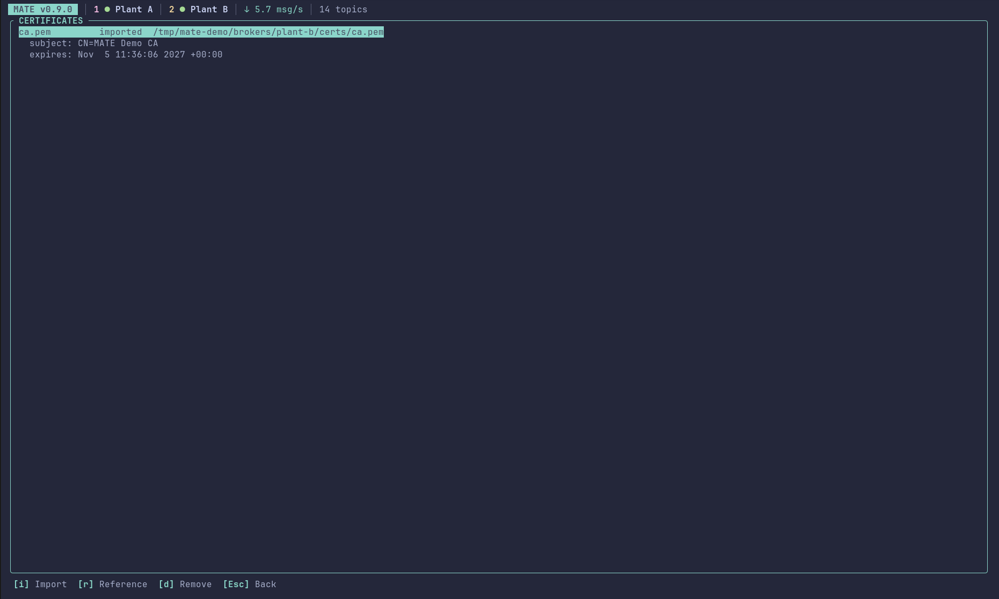
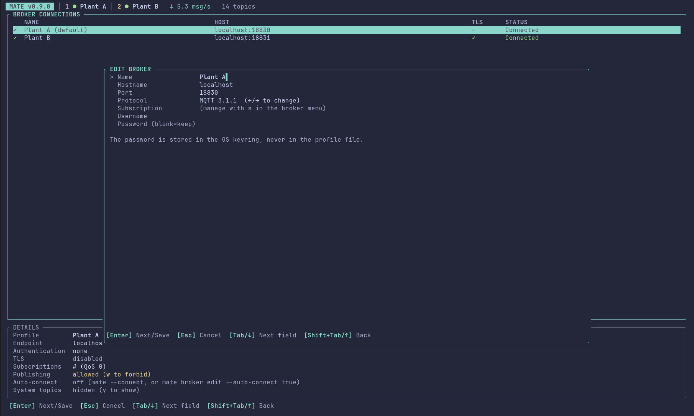

# Configuration and Certificate Architecture

## Paths and ownership

`directories::ProjectDirs` locates the MATE configuration root. The root `config.toml` contains general settings; broker profiles are stored independently at `brokers/<broker-id>/broker.toml`. Imported credentials are under `brokers/<broker-id>/certs/`. Broker IDs are lowercase ASCII slugs and are independent of editable display names.

`BrokerStore` is the only persistence/migration boundary. It loads root settings and profiles, migrates the older `[[brokers]]` root schema, writes profiles atomically, and supplies the profile directory used to resolve relative TLS paths. CLI and TUI must call this service rather than serialize profiles independently.

`CertificateService` validates and imports PEM files, manages external references, inspects X.509 metadata and validity dates, removes only profile-managed files, and produces separate certificate bundles. Imports copy file bytes, leaving source files unchanged. Import source components and managed certificate destinations are checked for symlinks; relative profile paths cannot contain parent traversal. The TUI uses the same service in its certificate view:

## Secrets and certificates

Broker usernames and `password_ref` are stored in TOML. Passwords are resolved from the operating-system credential store with service name `mate`; raw passwords are never configuration fields. Private key contents never enter TOML or logging. The TUI broker editor writes the password straight to the credential store:

TLS uses Rustls with platform trust roots and optionally adds the configured CA. Certificate and key files are parsed and expiry checked before a connection starts; Rustls still performs peer-chain and hostname verification during the handshake. The current rumqttc API ties the verified TLS name to the configured broker hostname, so an alternate `tls.server_name` is rejected.

Imported Unix private keys are set to mode `0600`. Windows imports use an ACL that grants the current user access while preserving SYSTEM and Administrators access. Other unsupported platforms fail closed for private-key imports. External key references remain under the caller's filesystem policy.

Standard profile exports omit the private-key path. Certificate bundles are a separate, explicit operation; use `mate broker export-certificates <id> <new-directory> --confirm-sensitive`, then `mate broker import-certificates <directory>`. Including a private key requires both `--include-private-key` and `--confirm-sensitive`. Bundle export refuses an existing destination and stages output before rename. Bundle import accepts only the expected `certs/ca.pem`, `certs/client.crt`, and `certs/client.key` entries, validates them before profile creation, and applies the normal imported-key permissions.

## Terminal UI architecture

The event loop in `main.rs` is the only place that touches both MQTT tasks and the UI. Broker tasks (`mqtt.rs`) send `BrokerEvent`s over a bounded channel; when it is full the message is dropped and counted. The loop moves events into `UiState::apply_broker_event`, executes `UiAction`s (connect, disconnect, test, quit), and redraws only when `UiState` reports a change (and at most every 33 ms).

`UiState` owns one `ConnectionInfo` (broker, state, last error, TLS use, protocol). The status bar, the broker table and the data-origin labels (`LIVE`, `RETAINED`, `CACHED`) are all derived from it; messages carry the store's sequence number, so a message counts as live only if it was stored after the latest ConnAck. Data belongs to one broker at a time (`topics_broker`); connecting to another broker clears it.

`TopicStore` keeps the latest message and a bounded history per topic (100 messages / 512 KiB) and evicts the oldest messages globally beyond 128 MiB / 200,000 messages, never the latest of a topic. Row lists are rebuilt only when the hierarchy or the filter changes. The inspector caches the parsed JSON for the displayed message (keyed by topic and sequence number), so selection, expansion and scroll positions are paths/pointers and survive updates. Historical messages are referenced by sequence number, which keeps the selection stable while newer messages arrive; if a pinned message is evicted the view returns to live data.

Layout is pure (`ui/layout.rs`): given the terminal area, panel preferences and focus it returns the rectangles to draw. Preferences that should survive a restart (history pane, pane widths, favorites per broker) live in `ui-state.toml` next to `config.toml`, handled by `ui_state.rs`; it is written only when the values differ from the file, atomically, and a failure is reported once instead of on every key press. It is deliberately separate from `broker.toml`, so UI preferences never change the profile schema. Clipboard copy writes an OSC 52 sequence from the event loop, because the terminal, not the OS, owns the clipboard in this design.

## Migration and verification

The old root profile array is loaded, assigned stable IDs, written into broker directories, and removed from the root settings file. Existing relative paths are interpreted relative to the new profile directory after migration; inspect and correct any old paths that were previously relative to the process working directory.

Unit tests cover migration, profile persistence, relative paths, safe certificate imports, expiry, private-key file mode on Unix, external references, and export confirmation. A live Mosquitto/TLS broker test and Windows build/ACL validation remain required before production deployment.
