# MATE user guide

This guide describes the terminal UI. Press `?` inside MATE for the key list of the version you run. The screenshots were taken from real sessions in a Linux terminal; the broker manager and broker editor screenshots predate the newest keys, so the tutorial and the key tables are authoritative.

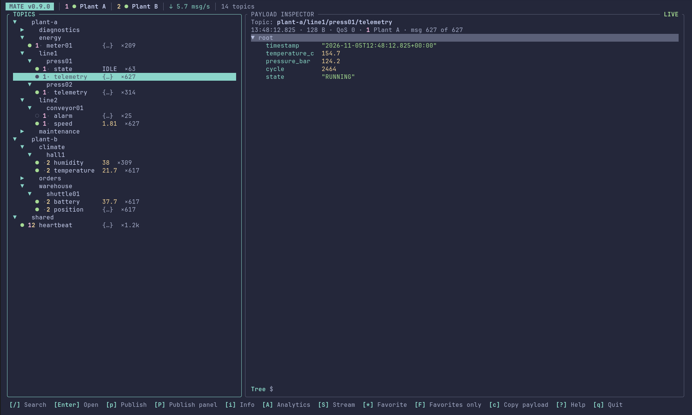

The screen has a status bar on top, one to three panels (topic explorer, payload inspector, optional history), and a context-sensitive shortcut bar at the bottom. The shortcut bar only lists keys that work for the focused panel or the open dialog.

## Tutorial

This walks through a first session: connect, find a topic, read its payload and metadata, compare messages, copy data and, if you want, publish.

### 1. Add a broker

Start `mate`, press `b` for the broker manager and then `a`. Enter a name, host and port, pick the protocol with `←`/`→` (MQTT 3.1.1 or MQTT 5) and a first subscription filter (`#` receives everything the broker allows; prefer a narrower filter such as `plant/#` on busy brokers). `Enter`, `Tab` or `↓` move to the next field, `Shift+Tab` or `↑` back, and `Enter` on the last field saves. Add a username and password if the broker needs them; the password goes to the OS keyring. For TLS and client certificates use the broker manager (`b`, then `v`) or `mate broker add --tls --ca ... --client-cert ... --client-key ...`.

`y` shows or hides the system topics of the selected broker (`$SYS/#`, for example `$SYS/broker/uptime` on Mosquitto). They are off by default because `#` never matches them (an MQTT rule) and they add a message every few seconds; the setting is saved per broker and applies at once to a connected one. Hiding them stops the subscription; topics already received stay in the list. The broker may refuse the subscription through its access rules; MATE then simply receives nothing. `mate broker edit <id> --system-topics true|false` does the same on the command line.

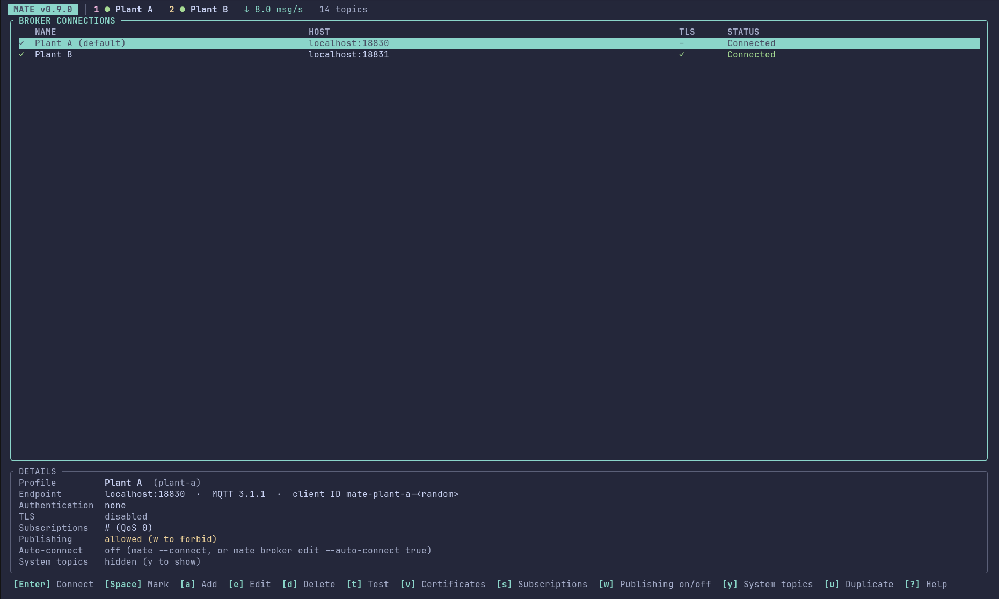

In the broker manager `t` tests a profile without touching your session and `Enter` connects.

### 2. Connect and look around

Press `o` (or `Enter` in the broker manager). The status bar goes from *Connecting* to *Connected* and shows the protocol, TLS state and message rate. Topics appear as a tree on the left: `l`/`Right` expands, `Left` collapses, `/` filters, `*` marks a favorite and `F` shows only favorites.


Select a leaf and press `Enter` to move into the payload inspector. JSON appears as a tree (`Enter`/`l` expands, `+`/`-` expand or collapse everything); `r` switches to the raw view. `Tab` returns to the topic list.

### 3. Check a topic's metadata

Press `i` on any topic or group to replace the payload with its metadata; `i` or `Esc` brings the payload back. The view stays open while you move through the topics, so you can scan them one after another. See [Topic metadata](#topic-metadata) for what it contains.

### 4. Follow changes over time

Press `h` to show the history. Every received message of the topic is listed with time, size, QoS and whether the payload changed. `Enter` pins an older message in the inspector, `l` returns to live data, and `d` marks a message so that a second `d` on another message shows a line diff. In the inspector `d` diffs the shown message against the previous one.

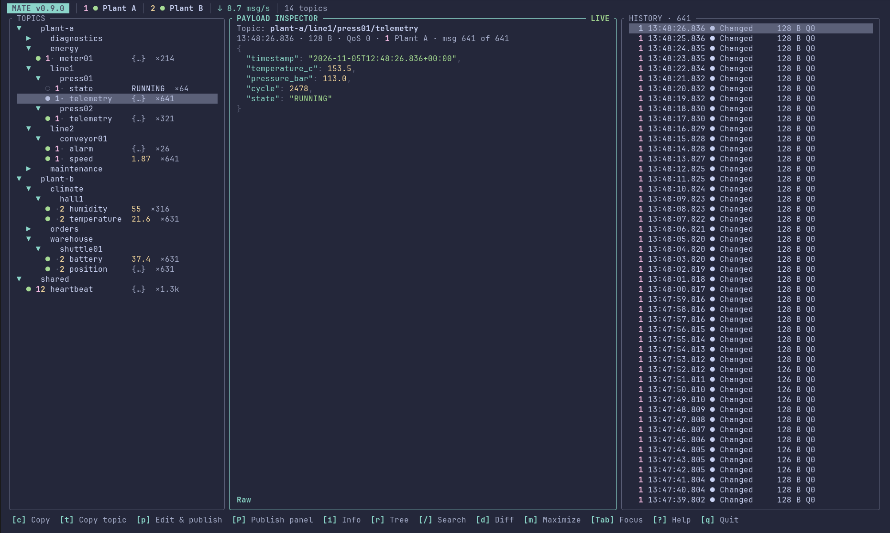

### 5. Copy what you need

`Ctrl+C` copies and does not quit MATE: in the inspector it copies the value under the cursor, elsewhere the payload. `c` does the same as `Ctrl+C` in the inspector and copies the payload in the topic and history panels, `C` copies the whole payload, `t` the topic. The status line names the clipboard tool that was used.

### 6. Choose what you subscribe to

In the broker manager `s` opens the subscriptions of the selected broker. `Space` switches a filter on or off without deleting it, `a` adds one, `d` removes one and `0`/`1`/`2` set the QoS. While connected the change takes effect immediately. Disabled filters stay in the profile but are not subscribed.

### 7. Publish (optional)

Publishing is off until you allow it for a broker with `w` in the broker manager and reconnect; the status bar then shows `publish on`. `p` opens the dialog with a review step before anything is sent. Retained messages and empty retained payloads (which delete the retained message) are called out explicitly.

### 8. Where to go from here

`?` lists every key, `m` maximizes the focused panel and `<`/`>` resize it. The layout is remembered; favorites are remembered per broker.

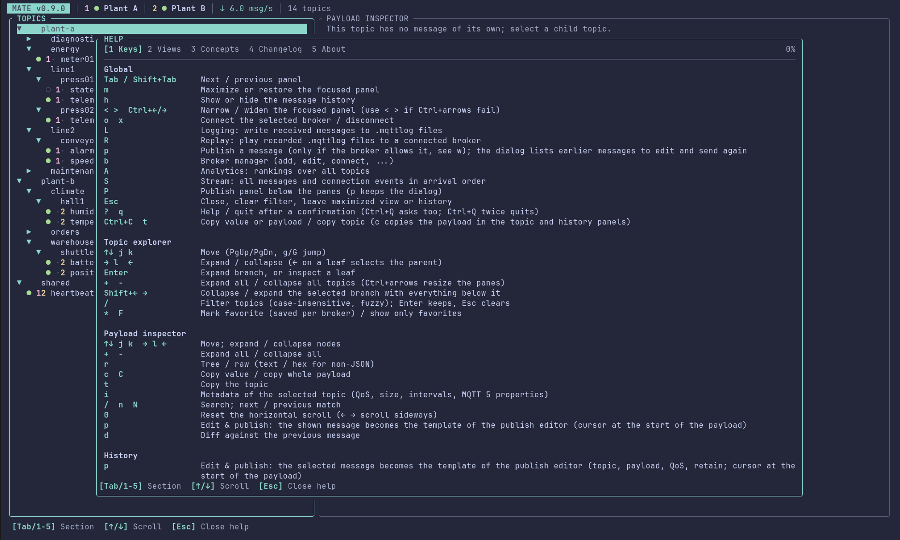

## Status bar and data origin

The status bar shows the broker, its connection state (connected, connecting, reconnecting, disconnected, error) and, only for an established connection, the MQTT version, whether TLS is in use, the incoming message rate and the number of discovered topics. After a failure it shows the last error; dropped messages (the bounded queue between the MQTT task and the UI was full) are counted and shown as a warning.

The inspector title tells where the shown message comes from:

- `LIVE`: received during the current connection.
- `RETAINED`: received during the current connection and flagged retained by the broker.
- `CACHED`: kept from before the current connection (or while disconnected). A message that was received earlier is cached even after a reconnect, until a new message replaces it.
- `HISTORY – hh:mm:ss`: you pinned an older message from the history.

Connecting to a different broker (or a different set of brokers) discards the previous data; reconnecting to the same ones keeps it.

## Global keys

| Keys | Action |
| --- | --- |
| `o` / `x` | Connect the selected (or only/default) broker / disconnect |
| `b` | Broker manager (there: `a` adds a broker, `Space` marks several to connect together) |
| `L` | Logging dialog (`.mqttlog` files) |
| `R` | Replay menu: play recorded `.mqttlog` files to a broker |
| `Tab`, `Shift+Tab` | Next / previous panel |
| `m` | Maximize or restore the focused panel (Tab then moves the maximized view) |
| `h` | Show or hide the history panel |
| `<` `>` or `Ctrl+Left` `Ctrl+Right` | Narrow / widen the focused panel; `<` `>` works in terminals that do not deliver Ctrl+arrows |
| `Esc` | Close dialog, close diff, clear search, leave maximized view, return from a historical message to live |
| `?`, `q` | Help, quit (`q` and `Ctrl+Q` ask first, `y` or `Enter` confirms; `Esc` never quits) |

The help (`?`, also in the analytics view and the broker manager) has five tabs: `Keys`, `Views` (analytics, broker manager, subscriptions, certificates, publish dialog), `Concepts` (counts, data origin, connections, publishing, limits), `Changelog` (the changelog of this build) and `About` (version, license, project and the folders MATE reads and writes). `Tab`/`Shift+Tab`, `←`/`→` or `1`-`5` switch tabs, `↑`/`↓`, `PgUp`/`PgDn`, `g`/`G` scroll; from the analytics view or the broker manager the help opens on the matching section. `Esc`, `?` or `q` closes it.

Below 60 columns only the focused panel is shown (switch with `Tab`); between 60 and 100 columns the history is stacked below the inspector.


## Topic explorer

`j/k` or the arrow keys move, `PgUp/PgDn` and `g/G` jump, `l` or `Right` expands (or steps into an open branch), `Left` collapses or selects the parent, `Enter` toggles a branch or opens a leaf in the inspector. `+` expands the whole tree and `-` collapses it to the top level (the selection moves to its top-level ancestor); `Ctrl+←/→` is taken by the pane resizing. `Shift+→` opens the selected branch with everything below it and `Shift+←` closes it with everything below it (on a leaf it closes and selects the parent); plain `→`/`←` change one level. Topics that arrive later start collapsed again. `/` filters topics incrementally (case-insensitive, fuzzy; `Enter` keeps the filter, `Esc` clears it). `*` marks the selected topic or branch as a favorite and `F` shows only favorites (a favorite branch includes everything below it); favorites are saved per broker. Filtering is local; MQTT subscriptions are not changed. The layout (history pane, pane widths) and the favorites are stored in `ui-state.toml` next to `config.toml`; deleting that file resets them.

Rows show a compact preview (`RUNNING`, `42.5`, `{…}`, `[12 items]`, `!` for broken JSON) and a dot for recently updated topics (`●` within five seconds, `○` otherwise). Previews are cut to the pane width and never overlap the border. Behind the preview a muted `×N` shows how many messages the topic received since the last connection attempt (`o`, or connecting from the broker manager); automatic reconnects do not reset it. Large numbers are abbreviated and rounded: `999`, `1.2k`, `15k`, `1.5M`. The count is what MATE received: a broker may drop QoS 0 messages for a client that cannot keep up with a burst, and those are not counted.

## Stream

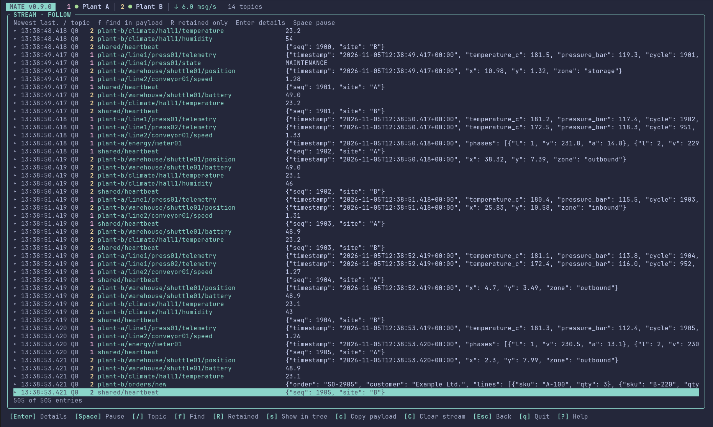

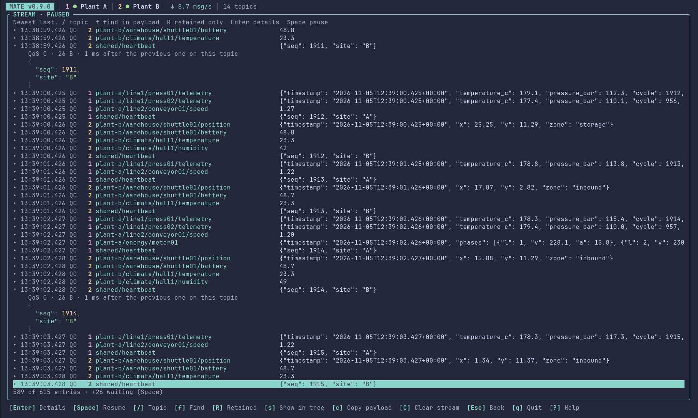

`S` opens a chronological list of everything MATE receives: every message of every subscription and the connection events (connecting, connected, reconnecting, errors) in arrival order, newest last. It keeps the last 50,000 entries and at most 64 MiB of payload for them; older entries are dropped and counted in the footer. The list follows the newest entry until you move up; `End` or `G` follows again.

Each line shows the time, the QoS (`Q0`/`Q1`/`Q2`) with `R` for retained and `D` for duplicate, the topic and the start of the payload. `Enter` expands an entry: QoS, retain flag, size, the time since the previous message on that topic, the MQTT 5 properties and the payload (JSON formatted, text, or a hex dump for binary; long payloads are cut after 40 lines, `c` copies the whole payload). `+` expands the selected entry and `-` collapses it, like `Enter` which toggles.

`C` empties the list (the filters stay) so you can start from a clean slate without reconnecting. `Space` pauses the list so you can read it; entries that arrive meanwhile wait (the footer counts them) and appear when you resume. `/` filters by topic (fuzzy, like the explorer), `f` finds text in payloads and MQTT 5 properties (ignoring ASCII case), `R` shows only retained messages and `e` hides or shows the connection events (they are hidden while a filter is active). `Esc` clears the filters, `Esc` again leaves. `s` shows the selected message's topic in the explorer, `c` copies the payload and `t` the topic.

The stream is not saved and is emptied when you connect to a different broker or set of brokers. Unlike the history it is not limited per topic, so a fast topic can push everything else out of the 50,000 entries; use the filters or the analytics lists to find those.

## Analytics

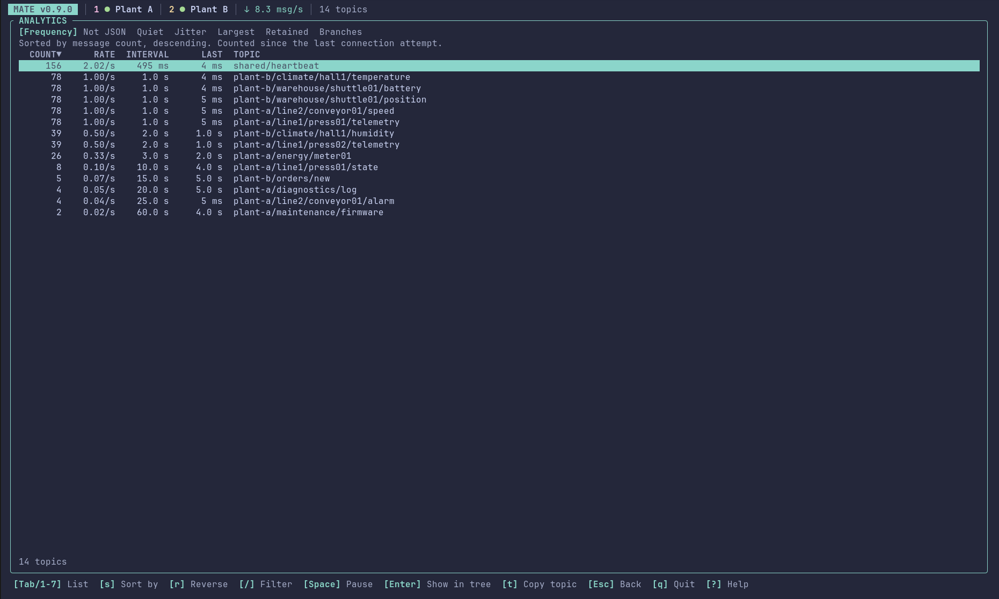

`A` opens the analytics view; `Esc` or `A` closes it. `Tab`/`Shift+Tab` or `1`-`7` switch between seven lists. `s` switches the sort column (the active one is marked `▼`/`▲` in the header), `r` reverses the order, `/` filters every list by topic name (fuzzy, like the explorer; for branches the filter applies to the topics before they are summed). `Enter` keeps the filter, `Esc` clears it, and `Esc` again leaves the view. `Space` pauses the view: the rows and the ages stop updating so you can read them, `PAUSED` shows in the title, and changing a sort, list or filter still recalculates from the live data; `Space` resumes.

`Enter` leaves the view and selects the topic in the explorer (its branch is expanded and any filter cleared), `t` copies the topic. The list is a snapshot that is recomputed about once per second and when an option changes, and shows at most 2,000 rows.

1. **Frequency**: every topic that received a message since the last connection attempt, with the message count, the message rate (from the topic's retained history, at most the last 100 messages), the average interval and the time since the last message. A topic that is published in every PLC cycle shows up at the top with a stable interval. Topics that are only cached from an earlier connection and sent nothing since are hidden; the footer says how many. Sort: count, rate.
2. **Not JSON**: the topics whose latest payload does not parse as JSON, with the kind (`broken`: starts like JSON but does not parse, with the parser message; `text`: plain text such as `RUNNING`; `binary`: not UTF-8; `empty`), the size and the start of the payload. `f` cycles the filter through all kinds, broken, text, binary and empty. Bare numbers and `true`/`false` are valid JSON and not listed. Sort: count, size.
3. **Quiet**: all topics by the time since their last message (`SILENT`) next to their usual interval (`USUAL`) and the factor between the two (`OVERDUE`, for example `90×` for a topic that normally sends every second and has been silent for 90 seconds). The overdue factor finds failed sensors and PLC tasks even when they are not the longest-silent topics; topics with a single message have no usual interval. Sort: silence, overdue factor.
4. **Jitter**: how irregular the timing of a topic is. `JITTER` is the standard deviation of the intervals divided by their mean (`0%` for a perfectly regular topic), next to the mean, minimum and maximum interval. Only topics with at least five messages in their history are judged, and a pause while MATE was disconnected counts as an interval. Sort: jitter, longest interval.
5. **Largest**: the size of the latest payload (`SIZE`) and the largest payload still in the history (`PEAK`), with the message count. Sort: size, peak, count.
6. **Retained**: topics whose latest message carried the retain flag, that is what the broker had stored when MATE subscribed and nobody has updated since; a live message normally arrives without the flag and removes the topic from this list. Shows size, age and the start of the payload. Sort: age, size.
7. **Branches**: totals per branch of the topic tree: messages since the last connection attempt, the summed message rate, the number of topics and the time of the latest message. `d` sets how many topic levels form a branch (1 to 6; topics with fewer levels count as their own branch). Sort: count, rate, number of topics.

## Payload inspector

JSON is shown as a collapsible tree (`Enter`, `l`, `Left`; `+` expands all, `-` collapses all) in the original key order; the JSON path of the selected node is shown at the bottom.

`r` switches to the raw view (pretty-printed and colored) and, for non-JSON payloads, between text and hex. `/` searches keys and values (`n`/`N` next/previous), `H`/`L`/`0` scroll horizontally, `d` diffs the shown message against the previous one, `c` copies the selected value, `C` the untouched payload and `t` the topic.

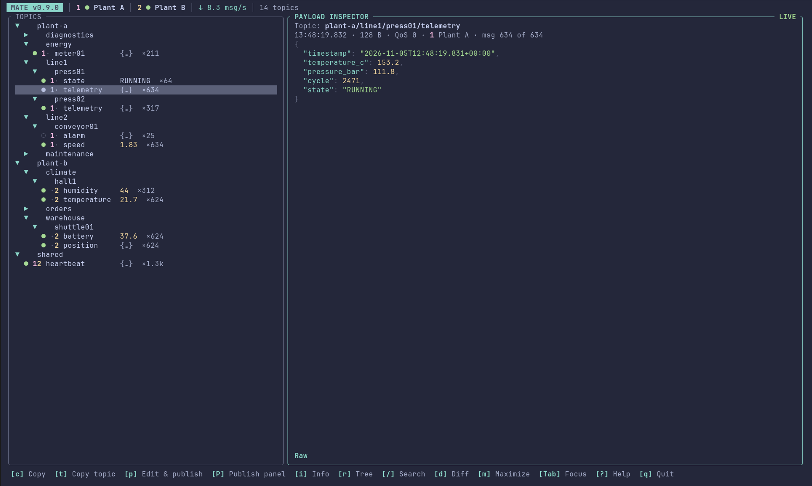

### Copying

`Ctrl+C` copies and does not quit the program (quit with `q` or `Ctrl+Q`): in the inspector it copies the value under the cursor, elsewhere the payload of the shown message. In the topic and history panels `c` copies the payload (of the history cursor in the history panel) and `t` the topic, so nothing has to be opened first. Text fields and dialogs ignore `Ctrl+C`.

MATE uses the system clipboard tool (`wl-copy` under Wayland, `xclip` or `xsel` under X11) and tells you which one worked. Without such a tool (for example over SSH) it falls back to the OSC 52 terminal escape sequence, which needs a terminal that allows it (inside tmux, `set-clipboard on` or passthrough is needed) and is limited to 100,000 bytes. Payloads above 64 KiB are not validated for the topic-row preview (shown as `{…}`/`[…]` by their first character); the inspector parses each message once, up to the 1 MiB packet limit.

## Topic metadata

`i` shows the metadata of the selected topic in place of the payload (`i` or `Esc` closes it, `↑`/`↓` scroll). It describes the message you are looking at (the latest one, or the one pinned from the history):

- **Topic**: full topic, number of levels and where the message came from (live, retained, cached, historical).
- **Message**: receive time and age, size, QoS, retain flag, DUP flag, payload type (JSON object/array/value, UTF-8 text, binary, empty) and whether the payload differs from the previous message.
- **Topic statistics**: number of messages received since connecting, how many are still in the history, the oldest one in the history, the interval between messages (average, minimum, maximum over the history) and how many payloads changed.
- **MQTT 5 properties** (only with MQTT 5 connections): content type, payload format, expiry, response topic, correlation data, user properties and subscription identifiers, as far as the publisher sent them. They follow the message data, so they are on the first screen. MQTT 3.1.1 messages have none; a profile that uses MQTT 3.1.1 never shows properties, even if the publisher sent them (check the protocol in the broker editor). The inspector also shows a one-line summary (`MQTT 5  origin=plc-7  ·  site=hall 2 …`) under the message data, user properties first.
- **Subtree**: for a group of topics (and for topics that also have children), the number of topics below, the messages received for all of them and the time of the latest one.

The statistics cover what MATE received during this run; the interval uses the retained history, so it reflects at most the last 100 messages.

## History

The panel title shows the same count for the selected topic (`HISTORY · 1.2k`), while the list itself holds only the most recent messages (see the limits below).

`/` in the history panel filters the messages of the topic by text: the payload and the MQTT 5 properties are searched (content type, response topic, correlation data and user properties, as key, value or `key=value`, so `origin=plc-7` works). Matching ignores ASCII case and looks at the first 64 KiB of a payload. `Enter` keeps the filter, `Esc` clears it; the panel title shows it (`HISTORY · /beta`). The filter stays when you select another topic, which makes it easy to look for the same thing everywhere. Cursor, pinning and copying work on the filtered list.

The history keeps up to 100 messages and 512 KiB per topic (and a global budget of 128 MiB / 200,000 messages), newest first, with time, size, QoS, retain flag (`R`) and whether the payload changed. `Enter` pins a message in the inspector; new messages keep arriving but do not replace it, and `l` returns to `LIVE`. `d` marks a message, a second `d` on another message opens a line diff of the two payloads.


## Broker manager

`b` opens a table of all profiles with name, host, TLS state (`✓`, `✓ mTLS`, `!` for unusable certificate files, `–` for plain) and status, plus a details pane. The status shown belongs to the profile itself: only the connected broker is marked connected.

`Enter` connects, `t` tests a connection (with a separate client ID if that broker is currently connected), `a/e/d` add/edit/confirm-delete, `u` duplicates a profile (the copy gets a new ID, the name "… copy" and its own client ID, and its own folder in the configuration directory; certificates imported into the original are not copied, external file references are), `*` sets or clears the default broker (the one `o` uses when none is selected), `w` allows or forbids publishing for the broker, `v` opens the certificate view, `x` disconnects. The CLI offers the same through `mate broker duplicate <id>` and `mate broker default <id>|--clear`.

**Renaming moves the folder.** The ID of a profile, which is also the name of its folder `brokers/<id>/`, follows the name: renaming `Production copy` to `Staging` (in the editor or with `mate broker edit <id> --name`) moves the folder to `brokers/staging/` (a number is added when that name is taken). The default-broker setting, the favorites and the publish history of the profile go along, and a generated client ID (`mate-<id>`) is renamed too. A password in the OS keyring is moved to the new reference; if that fails, the old reference keeps working. Log files that were already written keep their old name. A profile with a running connection cannot be renamed (the editor asks you to disconnect with `x` first).


The editor takes name, host, port, protocol (`←`/`→` switches between MQTT 3.1.1 and MQTT 5), a first subscription filter (only when adding), an optional username and a password. The password is stored in the OS keyring under `keyring:<broker-id>` and never written to a profile file; leave it blank when editing to keep the stored one.

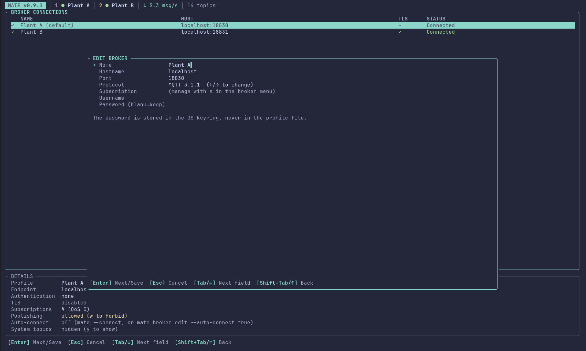

### Several brokers at once

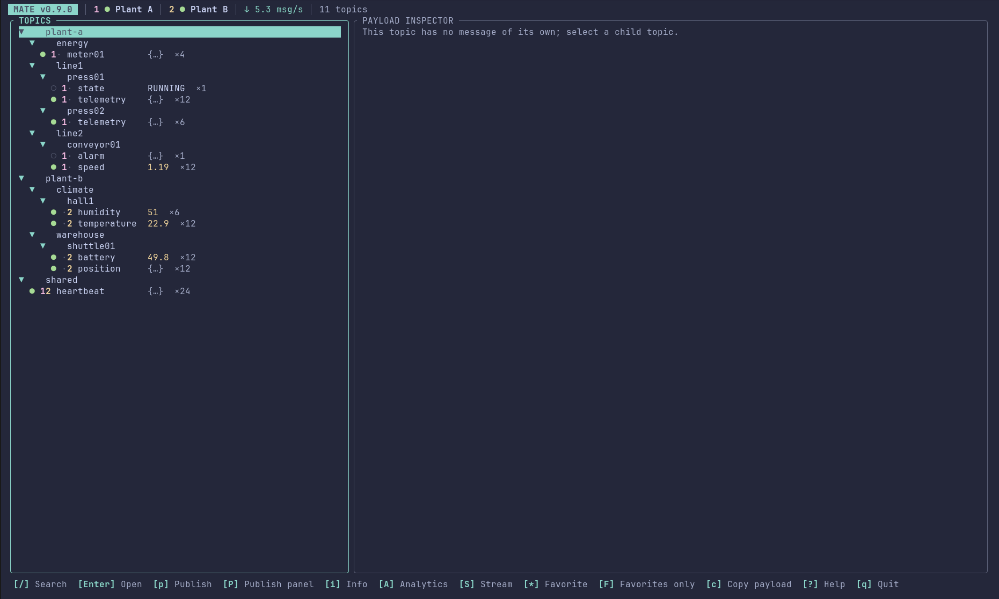

`Space` in the broker manager marks a broker (`✓`); `Enter` then connects every marked broker, and `x` disconnects them all. Without a mark `Enter` connects the highlighted broker alone, as before. On the command line repeat `--broker` together with `--connect`: `mate --connect --broker plant-a --broker plant-b`.

All brokers share one topic tree, one history and one stream, each with the subscriptions configured in its own profile. A digit shows where a message came from (also in the history panel, in the topic metadata and next to the time in the inspector): the header lists the brokers as `1 ● Plant A  2 ● Plant B`, a topic row starts with one column per broker (`1·` delivered by broker 1, `·2` by broker 2, `12` by both; `·` means this broker never sent it) and a stream row has the digit of its broker in front of the topic. The markers appear as soon as two brokers are connected. The same topic from two brokers is one entry whose history holds the messages of both.

A message you publish goes to the broker that delivered the selected topic, if that broker allows publishing; otherwise to the first connected broker that does. `Ctrl+B` in the publish dialog or panel picks the next one, and the dialog names the broker it is going to. Resending a message from the history goes back to the broker that delivered it. Subscriptions, exclusions, the publishing switch and certificates are still per profile, and the favorites of a set of brokers are remembered for exactly that set.

### Logging to .mqttlog files

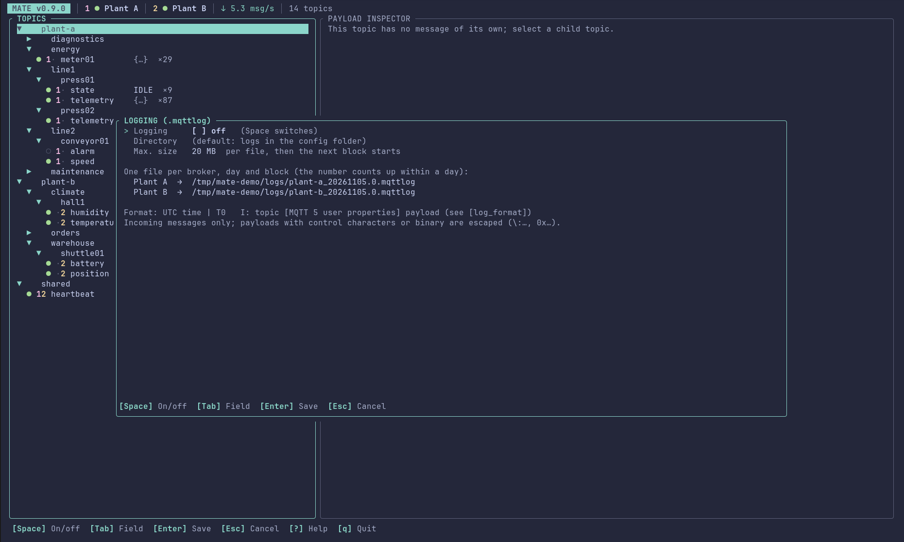

`L` opens the logging dialog (in the explorer, the broker manager, the stream, the analytics view and the replay menu). `Space` switches logging on, `Tab` moves to the directory (empty means the folder `logs` next to `config.toml`; `~/` and paths relative to the configuration folder work) and to the size limit, `Enter` saves, `Esc` cancels. The choice is kept in `ui-state.toml`.

While it is on, every message a broker delivers is appended to a file of that broker, one line per message:

```text
2026-10-23 10:53:51,998 | T0   I: site0/service/status [{"source":"plc"}] {"instancename":"RobotService_01_01","status":"RUNNING"}
```

The fields are the UTC time with milliseconds, a thread number (always `T0`, padded to four characters like the logs this layout follows), `I:` for an incoming message, the topic, the MQTT 5 user properties as a JSON array with one object per property (`[]` for none) and the payload. The payload is written as it is. Only where that would be ambiguous or break the line does it change form: a payload that is not UTF-8 is `0x` and hex digits, and one with control characters (line breaks included) or starting with `0x` or `\:` is `\:` followed by the text with `\\`, `\n`, `\r` and `\u{..}` escapes. So one message is always one line and the replay reads every message back exactly.

**File names and size.** Files are named `<broker-id>_<YYYYMMDD>.<n>.mqttlog`, for example `plant-a_20261029.0.mqttlog`. A new day starts a new file, and so does the size limit (default 20 MB, set in the dialog): before a line would take the file beyond it, the number `n` counts up (`..._20261029.1.mqttlog`). After a restart MATE continues the newest block of the day that still has room. Messages that exclusions drop are not logged; published messages are not logged either, only what arrives (including your own, if a subscription matches them). On Unix the files are readable by you only. If a file cannot be written, logging switches itself off and says why.

**Changing the layout.** The layout is not fixed in the program. `config.toml` can carry a `[log_format]` section; every key is optional and the values below are the defaults:

```toml
[log_format]
line = "{time} | T0   I: {topic} {properties} {payload}"
time = "%Y-%m-%d %H:%M:%S,%3f"
utc = true
pattern = ""
```

- `line` is the template for writing. `{time}`, `{topic}`, `{properties}` and `{payload}` are replaced, `{{` and `}}` are braces; `{time}` and `{topic}` are required. `time` is a strftime format (`%3f` is milliseconds). With `utc = false` the local time is written, and the day in the file name follows the same clock.
- `pattern` is a regular expression for reading lines back (the replay). It needs the named groups `time` and `topic`; `properties` (a JSON array of one-key objects) and `payload` are optional. The `time` group is parsed with `time`. Empty means the built-in reader, which understands the default layout whatever the thread number and level letter are. A payload read through `pattern` is decoded the same way as written (`0x...` and `\:...` forms), anything else is taken as it is.
- A template that cannot be used (unknown placeholder, missing `{topic}`), a wrong `time` format or an invalid `pattern` is reported at start and the default layout is used instead. The file is read when MATE starts.

Existing recordings keep working after a change of the layout only if `pattern` matches them; with the defaults, recordings of older MATE versions (local time, `T0  I:`) are read as before, and the replay uses only the differences between the times.

### Replaying recordings

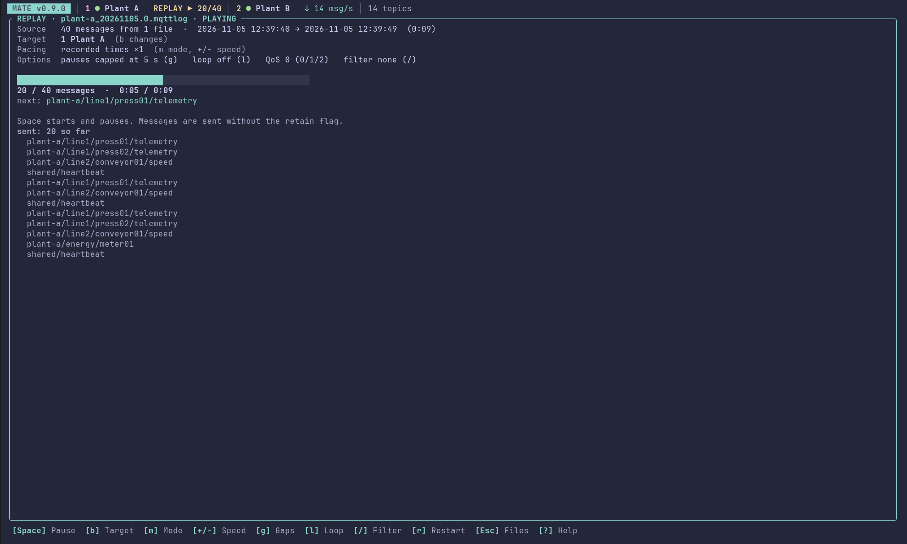

`R` (explorer or broker manager) opens the replay menu. It lists the `.mqttlog` files of the log directory; `Space` marks several (`a` marks all), `Enter` loads the marked ones (or the highlighted one), and `p` types another folder or a single file. Lines that are not in the log format are skipped and counted; a file from another tool with the same layout works too. The messages of all files are put in time order.

The player shows what was loaded, the target broker and the progress. The target is any connected broker that allows publishing (`b` switches between them), not only the one the recording came from; a broker that forbids publishing cannot be chosen. The first `Space` asks for confirmation (`y`/`Enter`), after that `Space` pauses and resumes. Changing the target asks again.

- `m` switches the pacing. *Recorded times* keeps the spacing of the timestamps and `+`/`-` change the speed (×0.1 to ×100). *Fixed rate* sends 1 to 1000 messages per second whatever the timestamps say.
- `g` caps long pauses between two messages (off, 1, 5 or 30 s, default 5 s), so a recording that spans hours does not wait for hours.
- `l` loops, `r` restarts, `/` replays only topics matching an MQTT filter such as `plant/#`, `0`/`1`/`2` set the QoS (the log has no QoS; default 0).
- Messages are sent without the retain flag. User properties go along on MQTT 5 connections. Topics a broker would refuse (`$SYS/...`, wildcards) and oversized payloads are left out and counted.
- A running replay shows `REPLAY ▶ n/m` in the header in every view. When the connection is busy, MATE waits and tries again; any other error pauses the replay and says why.

Replaying into a broker you are subscribed to shows the messages in the tree like any other, and logs them if logging is on.

### Subscriptions

A broker can have any number of subscriptions. `s` in the broker manager opens the list of the selected broker: `[x]` is enabled, `[ ]` is disabled (kept in the profile but not subscribed). `Space` or `Enter` toggles, `a` adds a topic filter with a QoS (`Tab` switches between the fields, `0`/`1`/`2` or `←`/`→` sets the QoS), `d` removes, and `0`/`1`/`2` changes the QoS of the selected entry. Everything is saved in `broker.toml`. If the broker is connected, the change is applied to the running connection immediately; otherwise it applies on the next connect. Topics that were already received stay in the topic list after an unsubscribe. The CLI offers the same: `mate broker subscriptions|subscribe|unsubscribe|subscription-enable|subscription-disable`.

### Excluding topics

A subscription can only say what to receive. To receive almost everything, subscribe to `#` and exclude what you do not want to see: `x` in the subscription list asks for an MQTT topic filter (`+` matches one level, `#` the rest), for example `+/hmi/#` for every `hmi` branch one level below the root, or `plant/line-1/#`. Messages whose topic matches an enabled exclusion are dropped as soon as they arrive, before they reach the topic list, history, stream or analytics. The entries show as `exclude` in the list; `Space` switches one off and on, `d` removes it. Changes apply to the running connection at once. On the command line: `mate broker exclude <id> '+/hmi/#'` and `mate broker unexclude <id> '+/hmi/#'`; `mate broker subscriptions <id>` lists both kinds.

Exclusions work inside MATE: the broker still sends the excluded messages, so they use bandwidth, and MQTT has no way to subscribe "to everything except". If bandwidth matters, use narrower subscriptions instead. Topics that were received before an exclusion was added stay in the topic list until you connect to another broker; they just stop updating.

### Starting, connecting and the window title

`mate --broker NAME` selects a profile (repeat it with `--connect` to connect several, see above); add `--connect` to connect at once. Without `--broker`, `--connect` uses the default broker or the only one. A profile with `auto_connect = true` (`mate broker edit <id> --auto-connect true`) connects at start whenever it is the broker MATE starts with, which makes `mate --broker NAME` enough for a shortcut.

The terminal title shows the broker and its state, for example `Plant A – Connected · MATE`, so several windows are told apart in the task bar. Terminals that keep a title stack (xterm and many others) get the old title back when MATE ends; the shell normally resets it anyway.

Several MATE instances can use the same configuration. `ui-state.toml` (layout, favorites, publish history) is merged when it is saved: an instance replaces only what it changed itself and keeps what another one saved. If two instances change the same broker's favorites at the same time, the last save wins for that broker.

### Several instances and the client ID

A broker allows only one session per client ID and drops the older one when a second client connects with the same ID; both then keep reconnecting and kicking each other. To avoid that, MATE appends a random suffix to the profile's client ID for every connection (`mate-production-3fa91c`), so any number of MATE instances can use one profile at the same time. The profile list shows the ID as `<client ID>-<random>`.

Some brokers only accept fixed client IDs (for example through ACLs). For such a broker set the ID with `mate broker edit <id> --client-id <fixed-id>`, which also turns the suffix off, or switch it explicitly with `--unique-client-id false|true`. With a fixed ID only one instance can be connected at a time; testing the connection of the connected broker (`t` in the broker manager) uses the ID with `-test` appended.

### MQTT version

Each profile uses MQTT 3.1.1 (default) or MQTT 5, chosen in the editor or with `mate broker add|edit --protocol mqtt311|mqtt5`; the status bar shows the version of the established connection. The connection never downgrades by itself. MQTT 5 support covers connecting, subscribing and publishing with payload and retain; MQTT 5 properties (user properties, content type, reason strings) are not displayed.

In the certificate view, `i/r/d` import / reference / confirm-remove a file; choose CA, client certificate or client key with `1/2/3`, then enter a path. The path field has a cursor: `←`/`→`, `Home`/`End`, `Delete` and `Backspace` edit at the cursor, and pasted text is inserted there.

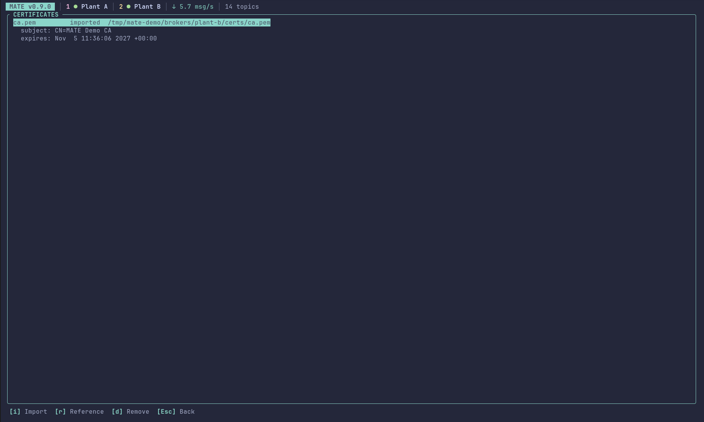

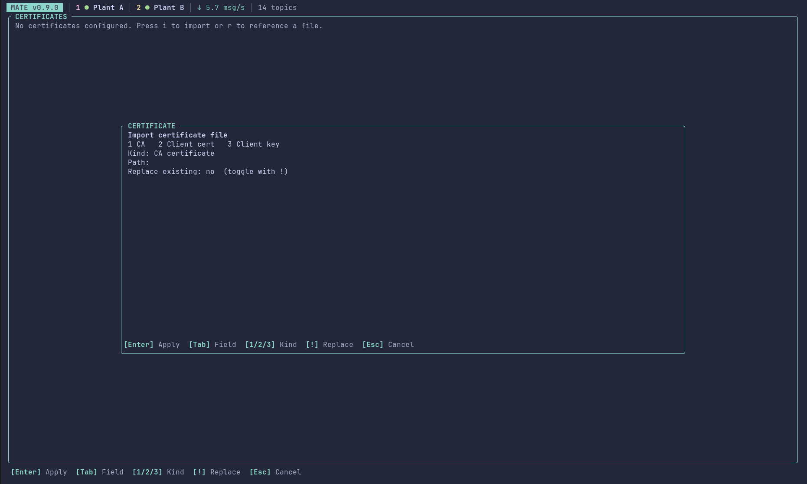

## Publishing

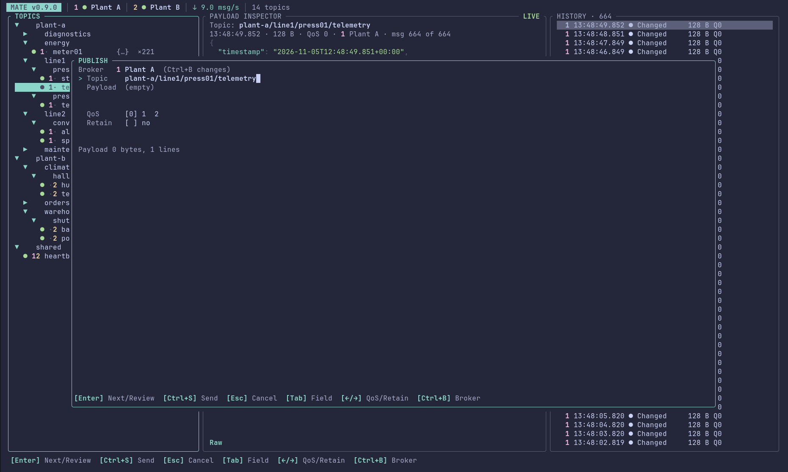

MATE never writes to a broker unless you allow it. Profiles are read-only by default and the status bar says `read-only`. To allow publishing for a broker, press `b`, select it and press `w` (or run `mate broker edit <id> --allow-publish true`); reconnect afterwards, then the status bar shows `publish on` and `p` becomes available.

`p` opens the dialog: topic (prefilled with the selected topic), payload, QoS (`0`/`1`/`2` or `←`/`→`) and retain (`Space`). `Enter` on the last field opens a review screen that shows what will be sent and warns about retained messages, about an empty retained payload (which deletes the retained message on that topic) and about JSON that does not parse; only `y` there sends the message. Topics with wildcards (`+`, `#`) or starting with `$` are rejected. 

**Editing a message you picked.** With the focus in the payload inspector or the history, `p` starts from that message instead of an empty form: topic, payload, QoS and retain are taken over (exactly as received), the focus is in the payload field and the cursor stands at its first character, so a sequence number or timestamp in the header is a few keystrokes away. Then edit and press `Enter` for the review, or `Ctrl+S` to send. Which message is used: the one shown in the inspector (the live one or the pinned one) or the one under the history cursor. The publish panel (`P`) works the same way: with the panel open, `p` in the inspector or history loads that message into it and replaces the draft there. With several brokers connected the message goes back to the broker that delivered it if that one allows publishing. MQTT 5 user properties are not part of the editor and are not sent; `Ctrl+S` in the history sends a message again with its properties unchanged. A payload that is not UTF-8 text is not copied (the form stays empty and says so).

### Publish panel

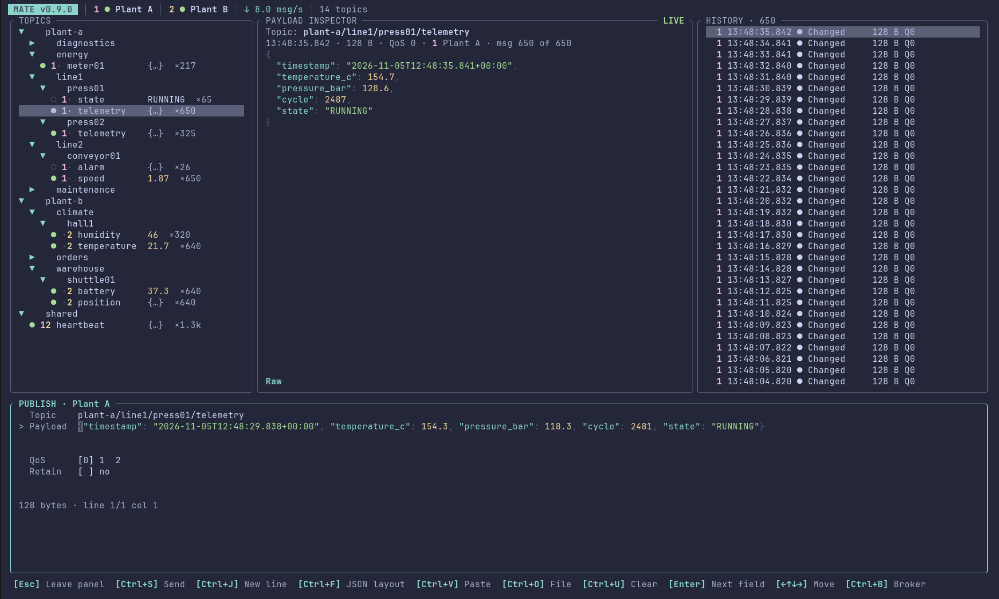

`P` shows the same editor as a panel docked below the explorer panes instead of a dialog: topics, inspector and history stay visible while you write, so you can look at a payload and copy it into the editor. `p` still opens the dialog when the panel is hidden, and focuses the panel when it is shown. While the panel has focus (`P` focuses it, or cycle with `Tab`) it takes all typing, so letters are not shortcuts there; `Esc` leaves the panel and `P` hides it. All fields, `Ctrl+S`, `Ctrl+O`, `Ctrl+F` and the list of recent messages work as in the dialog. The review step appears as a pop-up over the panel, and after sending the draft stays so you can change it and send again. Hiding the panel keeps the draft for the next `P`; the topic is prefilled only when the panel is first shown. The panel needs a terminal at least 22 rows high (below that, only the focused panel is shown) and publishing allowed for the broker, like the dialog.

With several brokers connected the dialog shows the target broker (`Ctrl+B` changes it) and keeps a separate list of earlier messages per broker.

`Ctrl+O` in the payload field asks for a file path (`~/` is expanded) and loads the file as the payload, replacing what is there; `Enter` loads, `Esc` cancels. Only UTF-8 text files up to the payload limit are accepted (binary payloads cannot be edited here), one trailing line break is dropped, and a failed load leaves the payload unchanged. The review step applies as usual.

`Ctrl+F` in the payload field switches a JSON payload between the indented form and one line (press it again to go back); the key order is kept.

`Ctrl+V` pastes the clipboard into the field (also `Shift+Insert`). MATE reads the system clipboard itself (`wl-paste`, `xclip` or `xsel`; `pbpaste` on macOS, PowerShell on Windows), so it works in terminals that pass `Ctrl+V` through instead of pasting; terminals that paste on their own (`Ctrl+Shift+V`) deliver the text directly. Line breaks of any kind become new lines in the payload. Other one-line fields (filters, searches, the replay path) take a pasted text as typed characters. Unassigned `Ctrl`+letter combinations no longer type the letter.

The payload field is a small multi-line editor. A payload that starts with `{` or `[` is colored like the inspector's raw view (keys, strings, numbers, `true`/`false`/`null`), also while it is incomplete or invalid; the coloring is only a visual aid and does not change what is sent. It grows with the content (up to 12 rows, fewer on a small terminal) and shows a cursor, so you see what you are about to send. `←`/`→` move the cursor, `↑`/`↓` move between lines (and leave the field at the first or last line), `Home`/`End` jump to the start or end of a line, `Delete` and `Backspace` remove characters. `Enter` still moves to the next field; `Ctrl+J` (or `Alt+Enter`) inserts a line break, and pasted text keeps its line breaks. `Ctrl+F` re-formats the payload as indented JSON (it refuses text that is not valid JSON and leaves it unchanged), `Ctrl+U` clears the field. The topic field has the same cursor keys (`←`/`→`, `Home`/`End`, `Delete`). The review screen shows the payload lines, not just the first one. The line below the fields shows the payload size and the cursor position.

Below the fields the dialog lists the last 20 messages you published to this broker (newest first, with time, QoS, retain flag, topic and the start of the payload). Press `↓` from the last field (or `Tab`) to move into the list, `↑`/`↓` select, `Enter` loads the selected message into the fields with the cursor in the payload, so you can edit it and send it again through the normal review step. `d` forgets an entry. Only successfully sent messages are remembered, identical ones appear once, and payloads above 16 KiB are sent but not remembered. The list is stored per broker in `ui-state.toml` as plain text, so do not publish secrets you do not want kept there.

`Ctrl+S` sends the message right away from the dialog, without the review step; in the review it confirms like `y`. Sending right away still stops at the review for the two mistakes the review exists for: an empty retained payload (which deletes the retained message) and text that looks like JSON but is not valid. An invalid topic or payload size is reported in the dialog. (`Ctrl+Enter` is not used: most terminals cannot tell it from `Enter`, and some bind it to window actions.)

### Sending a message from the history again

`Ctrl+S` in the history panel sends the selected message again, right away and without a dialog: same topic, the original payload bytes, and the QoS and retain flag **as MATE received them**. The same works in the inspector while a historical message is pinned. It only works when publishing is allowed for the broker (`w`) and the connection is established; otherwise the status line says why. Nothing happens in the topic panel, so a stray `Ctrl+S` cannot publish. The result is shown like any other publish and the message also enters the publish history. Note that a subscriber receives at most the QoS it subscribed with, and a broker clears the retain flag on live deliveries, so a message received at QoS 0 is sent again at QoS 0. To change anything first, copy the payload (`c`) and use `p`.

The message is handed to the connection immediately; for QoS 0 the broker does not confirm anything, so "Published" means "sent", not "delivered".

## Known limits

- The history key `h` replaces the vim-style collapse key (use `Left`); connecting is `o` because `c` copies.
- MQTT 5 properties are shown in the metadata view (`i`) but not used elsewhere.
- The screenshots of the broker manager and the broker editor predate the subscription and protocol keys.
- Copying without a clipboard tool depends on OSC 52 terminal support.
- Linux is the supported platform; Windows is only cross-compiled.
